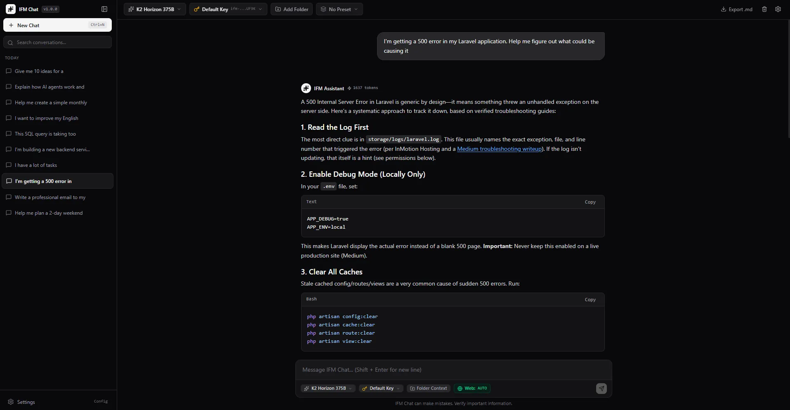
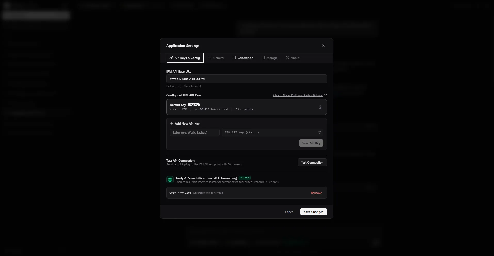
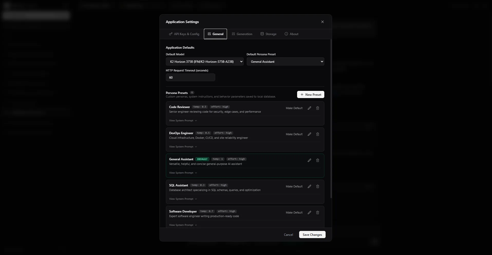
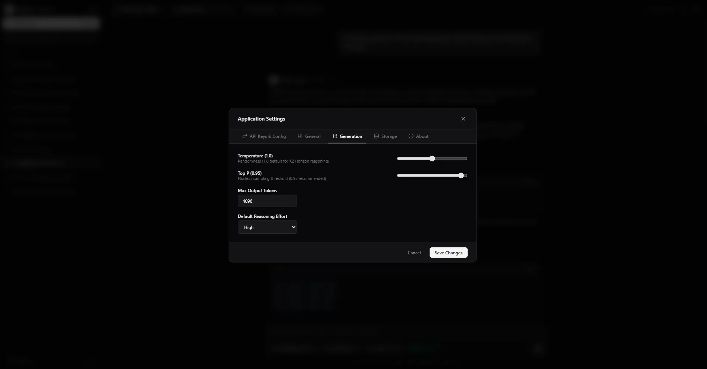
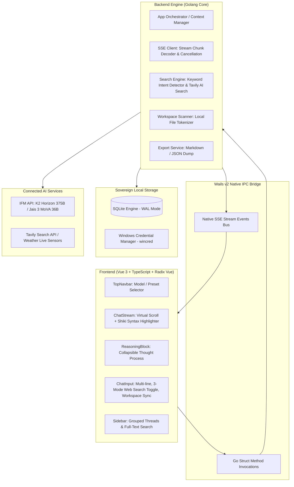

# IFM Chat — Enterprise Native Desktop AI Client

<p align="center">
  
</p>

<p align="center">
  <strong>High-performance, sovereign desktop AI client for the Institute of Foundation Models (IFM), powered by Go (Wails v2), Vue 3, and deep reasoning model architectures with real-time web search grounding.</strong>
</p>

<p align="center">
  
  
  
  
  
  
  
  
</p>

<p align="center">
  
</p>

---

## 🔍 What is IFM (Institute of Foundation Models)?

The **Institute of Foundation Models (IFM)** is a global frontier artificial intelligence research organization dedicated to developing next-generation foundation models with deep reasoning, high-efficiency chain-of-thought, and sovereign multilingual capabilities.

Key flagship architectures built and hosted by IFM include:

- **`IFM/K2-Horizon-375B-A23B`**: Flagship ultra-scale mixture-of-agents reasoning model engineered for mathematical problem-solving, advanced software architecture, complex code generation, and multi-step cognitive reasoning with extended deliberation tokens (`reasoning_content` / `think`).
- **`IFM/Jais-3-MoVA-36B-A4B`**: State-of-the-art bilingual foundation model setting the benchmark for Arabic-English cross-lingual reasoning, cultural alignment, and enterprise document comprehension.

**IFM Chat** serves as the official open-source, sovereign desktop workstation for interacting with IFM models with zero cloud telemetry and zero third-party data retention.

---

## Executive Overview

**IFM Chat** is a sovereign, secure enterprise AI desktop client engineered with **Go (Wails v2)** and **Vue 3 + TypeScript**. It delivers sub-millisecond local latency, real-time Server-Sent Events (SSE) token streaming, and hardware-isolated credential protection.

Designed following strict enterprise security standards:

- **Zero Cloud Data Leakage**: Chat history, sessions, workspace documents, and system presets remain strictly local on the host machine.
- **Hardware-Backed Credential Security**: API keys are isolated in the **Windows Credential Manager** (`IFMChat/APIKey` and `IFMChat/TavilyKey`), preventing plaintext exposure in databases or config files.
- **Real-Time Web Search Grounding**: Integrates **Tavily AI Search** with configurable 3-state execution (`AUTO`, `FORCE ON`, `OFF`), transparent credit monitoring, and customizable JSON keyword triggers.
- **Pure-Go Embedded Persistence**: Single-process, CGO-free SQLite storage using WAL (Write-Ahead Logging) mode with automatic backup and transactional integrity.

---

## 🖼️ Application Showcase

|                               **Sovereign AI Chat Workspace**                               |                    **Multi-Key & Web Grounding (`Settings > API`)**                    |
| :-----------------------------------------------------------------------------------------------: | :--------------------------------------------------------------------------------------------: |
| [](docs/screenshots/ifm-chat-workspace.webp) | [](docs/screenshots/settings-api-keys.webp) |
|              *Real-time SSE token streaming, reasoning deliberation & code blocks*              |                 *Hardware-isolated keys in Windows Vault & Tavily AI search*                 |

|                          **Custom Persona Presets (`Settings > General`)**                          |                       **Inference Controls (`Settings > Generation`)**                       |
| :---------------------------------------------------------------------------------------------------------: | :--------------------------------------------------------------------------------------------------: |
| [](docs/screenshots/settings-persona-presets.webp) | [](docs/screenshots/settings-generation.webp) |
|                       *Create & save custom system personas and tailored behavior*                       |                     *Fine-tune Temperature, Top-P, tokens & reasoning effort*                     |

---

## Architecture & System Design



---

## Key Enterprise Capabilities

### 1. Frontier Reasoning Engine (`reasoning_content`)

- **Dedicated Thought Process Rendering**: Separate stream parsing for `reasoning_content` vs standard `content`. Real-time pulse animations during the reasoning phase.
- **Reasoning History Preservation**: Preserves raw thinking blocks across conversation rounds for contextual chain-of-thought continuity.
- **Instant Model Switching**: Switch models on-the-fly mid-chat without breaking message history or active context parameters.

### 2. Autonomous Web Search Grounding (Tavily AI Search)

- **Real-Time Information Retrieval**: Connects frontier IFM models to live internet data (breaking news, fuel prices, stock quotes, weather, live documentation).
- **3-Mode Composer Toggle**:
  - `🌐 Web: AUTO`: Automatically triggers web grounding when user queries match real-time keywords defined in `keywords.json` (saves credits on pure coding/theoretical queries).
  - `🌐 Web: ON`: Forces web search for every prompt.
  - `🌐 Web: OFF`: Disables web browsing completely for zero-credit local reasoning.
- **Credit & Token Transparency**: Assistant headers display real-time token counts alongside search credit usage (e.g. `🌐 Tavily AI Search • 1 credit  ⚡ 412 tokens`).
- **Resilient Fallback Pipeline**: Built-in fallback to specialized weather sensors (`wttr.in`) and Wikipedia OpenSearch when appropriate.

### 3. Workspace & Codebase Intelligence

- **Local Folder Ingestion**: Index and attach local directories or code files directly into conversations with zero telemetry.
- **Context Injection**: Intelligently summarizes and passes workspace files into model prompts with syntax-aware markdown highlighting.

### 4. Native Desktop Optimization

- **Auto-Maximised Launch**: Opens automatically in maximized window mode (`options.Maximised`) for an optimal desktop workstation experience.
- **Ergonomic Workspace Layout**: Collapsible sidebar (`Ctrl + B`), fast chat creation (`Ctrl + N`), message regenerate/edit controls, and export to `.md`.
- **Custom Confirmation Modals**: Native **Radix-vue** `AlertDialog` modals for deletion confirmations (no archaic browser dialogs).
- **Ultra-Lean Resource Footprint**: Native WebView2 integration keeps memory utilization minimal (<100MB idle).

### 5. Enterprise Security & Compliance

- **Credential Isolation**: Uses `wincred` to interact directly with Windows Vault / Credential Manager.
- **Safe HTML Rendering**: Multi-pass XSS defense combining `markdown-it`, `DOMPurify`, and syntax highlighter (`shiki`).
- **Audit & Portability**: Single-click full database export and import in standard JSON schema.

---

## Technical Specifications

| Component                   | Enterprise Standard Implementation                             |
| --------------------------- | -------------------------------------------------------------- |
| **Operating System**  | Windows 10 / Windows 11 (64-bit AMD64)                         |
| **Runtime Backend**   | Go `1.22+` / `1.27` (`CGO_ENABLED=0`)                    |
| **Desktop Shell**     | Wails v2 (`v2.17.1`) with Microsoft Edge WebView2            |
| **Client Core**       | Vue 3 (Composition API, `<script setup>`), TypeScript 5      |
| **Design System**     | shadcn-vue / Radix Vue + Tailwind CSS (Monochrome Dark)        |
| **Web Search**        | Tavily AI Search API + Go embedded `keywords.json`           |
| **Code Highlighting** | Shiki (`github-dark` / `vitesse-dark` themes)              |
| **Embedded DB**       | `modernc.org/sqlite` (Pure Go, WAL enabled, Foreign Keys ON) |
| **Secrets Engine**    | Windows Credential Manager (`wincred`)                       |
| **Default Models**    | `IFM/K2-Horizon-375B-A23B`, `IFM/Jais-3-MoVA-36B-A4B`      |

---

## Directory Structure

```text
ifm-chat-client/
├── app.go                 # Core application controller & Wails bridge methods
├── main.go                # Native window configuration & initialization
├── wails.json             # Wails project manifest & build definitions
├── internal/
│   ├── search/            # Multi-provider web search engine
│   │   ├── service.go     # Tavily AI Search, weather, and fallback implementations
│   │   └── keywords.json  # Embedded keywords dictionary for intent detection
│   ├── conversation/      # Conversation state management and title generation
│   ├── database/          # SQLite pure-Go storage layer & migration routines
│   ├── ifm/               # IFM HTTP Client, SSE decoder, and data structures
│   ├── security/          # Windows Credential Manager vault (wincred)
│   ├── settings/          # Application configuration repository
│   └── workspace/         # Local folder scanner and tokenizer
├── build/
│   ├── appicon.png        # Official high-resolution 1024x1024 application icon
│   └── windows/
│       ├── icon.ico       # Multi-resolution Windows system icon (16-256px)
│       └── info.json      # Binary metadata and executable versioning
└── frontend/
    ├── src/
    │   ├── App.vue        # Primary application layout & keyboard accelerators
    │   ├── components/
    │   │   ├── chat/      # ChatInput, MessageItem, ReasoningBlock, TopNavbar
    │   │   ├── sidebar/   # Sidebar navigation, search, and thread grouping
    │   │   ├── ui/        # Custom Radix-vue ConfirmDialog components
    │   │   └── settings/  # API key, Tavily key, Model catalog, and Preset configuration
    │   ├── composables/   # Reactive state management (useChat, useConversations)
    │   └── utils/         # Markdown processing and sanitization
    ├── package.json
    └── vite.config.ts
```

---

## Installation & Build Pipeline

### Prerequisites

1. **Go**: `1.22` or later ([Download](https://golang.org/dl/))
2. **Node.js**: `v20.x` or `v22.x` ([Download](https://nodejs.org/))
3. **Wails v2 CLI**:
   ```cmd
   go install github.com/wailsapp/wails/v2/cmd/wails@latest
   ```
4. **Environment PATH**: Ensure `%USERPROFILE%\go\bin` is present in your system `PATH`.

---

### Development Mode

Run the application with live hot-reloading (both Go backend and Vue frontend):

```powershell
# Run development server
wails dev
```

---

### Production Compilation

Generate an optimized, standalone Windows executable:

```powershell
# 1. Verify Go module dependencies
go mod tidy

# 2. Build production assets and compile binary
wails build -platform windows/amd64 -clean
```

The resulting standalone executable will be packaged at:

```text
build\bin\IFMChat.exe
```

> **Deployment Note:** `IFMChat.exe` is completely portable and self-contained. It requires no external database, node server, or installation wizards.

---

## Keyboard Shortcuts

| Shortcut          | Description                               |
| ----------------- | ----------------------------------------- |
| `Ctrl + B`      | Toggle / Collapse Sidebar navigation      |
| `Ctrl + N`      | Create a new conversation thread          |
| `Enter`         | Send message                              |
| `Shift + Enter` | Insert new line in message editor         |
| `Escape`        | Close active modal / Cancel thread rename |

---

## Data Management & Storage Paths

All persistent application data is localized within the operating system's standard user profile:

- **Database Directory**: `%APPDATA%\IFMChat\database\ifm-chat.db`
- **Application Logs**: `%APPDATA%\IFMChat\logs\`
- **Credentials Vault**: Stored in Windows Credential Manager under Targets:
  - `IFMChat/APIKey` (IFM Model Authentication)
  - `IFMChat/TavilyKey` (Tavily AI Search Engine)

---

## License & Attribution

Designed and developed by **Yoga Mahendra** for enterprise AI workflows.
Powered by [Wails](https://wails.io), [Vue 3](https://vuejs.org), and [Institute of Foundation Models (IFM)](https://ifm.ai).
